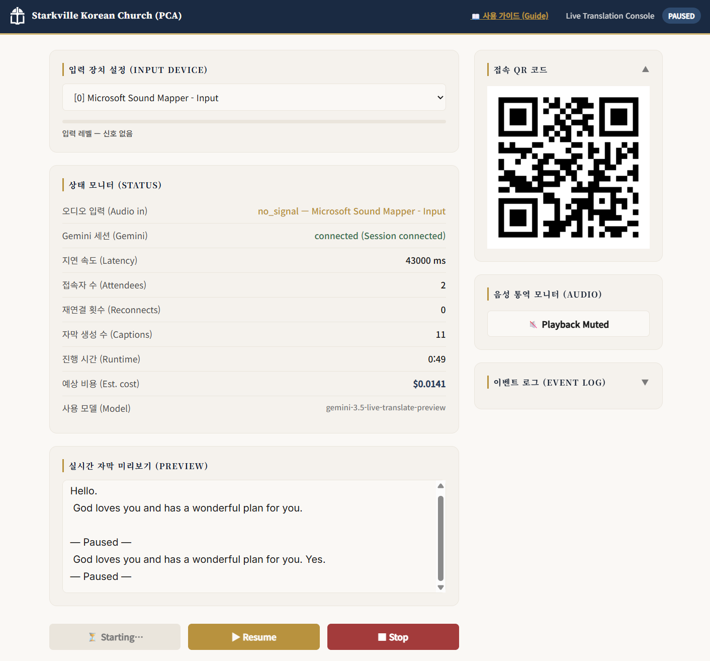
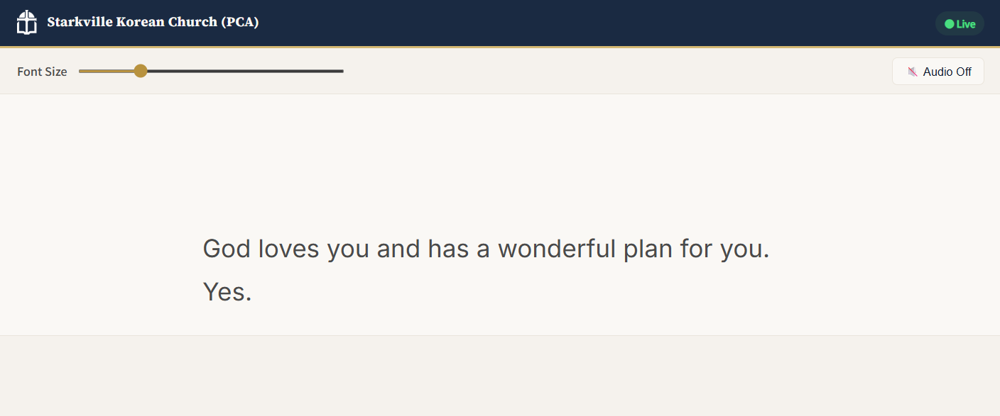
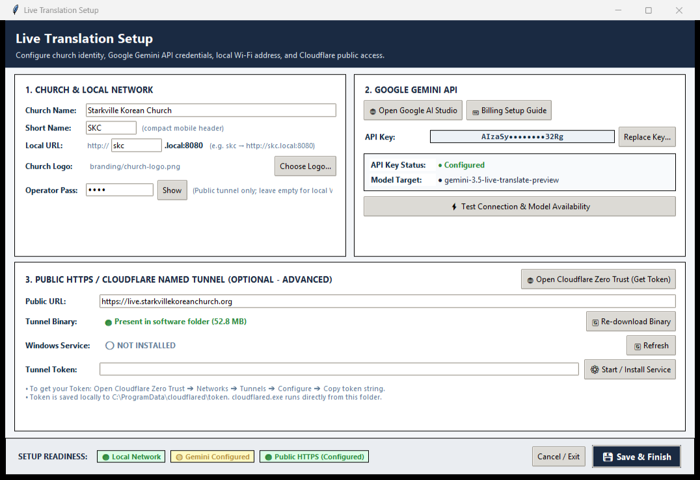

# 실시간 예배 번역 시스템 / Live Translation System
### 스탁빌 한인 교회 (PCA) 실시간 한영 번역 서비스 / Real-Time Korean-English Translation for Church Services

[🐍 Python](https://www.python.org/) | [⚡ FastAPI](https://fastapi.tiangolo.com/) | [🎙️ PyAudio](https://people.csail.mit.edu/hubert/pyaudio/) | [♊ Gemini Live API](https://ai.google.dev/gemini-api/docs/live-api) | [🔊 Web Audio API](https://developer.mozilla.org/en-US/docs/Web/API/Web_Audio_API) | [💬 Server-Sent Events](https://developer.mozilla.org/en-US/docs/Web/API/Server-sent_events)

---

처음 설치와 QR 안내: [한국어 설치·사용 안내](</docs/한인교회 통역 시스템 처음 셋업 (SKC-translate).md>) · [한국어 PDF](</docs/한인교회 통역 시스템 처음 셋업 (SKC-translate).pdf>) · [English PDF](/docs/SKC_Live_Translation_Setup_Guide_EN.pdf). 설정을 저장하면 프로그램 폴더에 `qr_local.png`와 인쇄용 `qr_local_print.html`이 생성됩니다.

언어 선택 / Select Language:
- 🇰🇷 [한국어: 실시간 예배 번역 시스템](#korean-section)
- 🇺🇸 [English: Live Translation System](#english-section)

***

<details open>
<summary><b>🇰🇷 한국어 버전 (클릭하여 접기/펼치기)</b></summary>
<a name="korean-section"></a>

## 📌 목차
1. [시스템 소개](#1-시스템-소개)
2. [📖 문서 가이드 디렉토리](#2-문서-가이드-디렉토리)
3. [🖥️ 사용자 및 관리자 화면 구성](#3-사용자-및-관리자-화면-구성)
4. [💻 로컬 개발 환경 실행](#4-로컬-개발-환경-실행)
5. [💰 서비스 운영 비용 분석](#5-서비스-운영-비용-분석)

---

## 1. 시스템 소개

예배용 실시간 다국어 동시 통역 시스템입니다. 마이크로 들어온 오디오를 Google Gemini Live API로 70개 이상 언어(영어, 중국어, 스페인어, 우크라이나어 등)로 실시간 번역해 현장 Wi-Fi나 공용 HTTPS로 접속한 참석자 스마트폰 브라우저에 자막과 음성을 전달합니다. 번역 일시정지 중에도 이어지는 MP3 입력 녹음, 확정 자막의 수동 이름 교정, 주석을 보존하는 설정 엔진, 인트라넷과 인터넷 환경에 맞춘 적응형 모드를 갖춰 스탁빌 한인 교회(PCA)를 비롯한 다문화 예배 환경에 맞춰 쓸 수 있습니다.

---

자동 재연결과 일시정지 후 재개는 저장한 문맥을 사용합니다. 새 문맥이 필요하면 `서비스 종료 → 번역 시작`을 사용하며 이후 자동 교체는 다시 문맥을 재개합니다. 찬양의 오인식이 모두 해결된 것은 아니며 [전체 예배 검증 결과](/docs/b1_full_service_validation.md)에 적용 범위와 한계를 기록했습니다.

## 2. 문서 가이드 디렉토리

시스템 운영과 유지보수에 필요한 모든 문서는 아래 가이드로 분리해 관리합니다. 필요한 문서의 링크를 눌러 확인하세요.

### 👥 1. 봉사자 및 운영자용

* **봉사자 운영 매뉴얼 (Operator Manual)** - 마이크 입력 확인, 시작/일시정지/종료 조작, QR 코드 제공 안내
  * **[🖥️ 웹 브라우저 가이드 (how_to_use.html)](how_to_use.html)**

### 🛠️ 2. 기술 유지보수자용

* **기술 유지보수 및 아키텍처 플랜 (Architecture Plan)** - 파일 구조, 단계별 개발 현황, 기술 스택, 설정 참고
  * **[📖 docs/PLAN.md](docs/PLAN.md)**

* **개발 빌드 및 히스토리 로그 (Build Walkthrough)** - 세션별 개발 기록, 검증 프로토콜, 기술 의사결정 회고
  * **[📖 docs/WALKTHROUGH.md](docs/WALKTHROUGH.md)**

* **기술 참고서 (Technical Reference)** - FastAPI 라우트, Gemini Live 세션, 오디오 파이프라인, asyncio 패턴
  * **[📖 docs/TECHNICAL.md](docs/TECHNICAL.md)**

* **단일 실행 파일 빌드 기록 (Build Executable Guide)** - PyInstaller spec 설정, frozen exe 코드 변경
  * **[📖 docs/BUILD_EXE.md](docs/BUILD_EXE.md)**

### 🔐 3. 운영 및 소유권 관리

* **사이트 운영 및 비밀키 관리**
  * **API 키 발급 및 등록**: [Google AI Studio](https://aistudio.google.com/)에서 API 키를 발급받고 결제 정보(Billing)를 등록해야 합니다. 무료 키는 60분 연속 가동 시 분당 사용 한도를 초과해 자막이 끊길 수 있습니다.
  * **환경 변수 파일 설정**: 발급받은 키는 프로젝트 루트 폴더의 `.env` 파일에 `GEMINI_API_KEY=your_key` 형식으로 저장해 안전하게 관리합니다.
  * **로컬 인프라 제어**: `config.yaml` 파일에서 로컬 PC의 입력 믹서 번호 등을 지정합니다.
  * **소유권 이양**: 교회 시스템이 계속 안정적으로 운영되도록 GitHub 권한과 Google Billing 소유권을 다음 관리자에게 안전하게 넘기는 절차를 안내합니다.

---

## 3. 사용자 및 관리자 화면 구성

### 1. 관리자 제어 콘솔 (`/admin`)
참석자용 공용 HTTPS QR 코드 생성, 오디오 입력 기기 설정, 다국어 UI 전환(`[ English | 한국어 ]`), 제미나이 번역 엔진 시작/일시정지/종료 제어를 맡는 중앙 관리 화면입니다.



* **주요 요소 설명**:
  * **언어 선택기 (`[ English | 한국어 ]`)**: 상단 헤더에서 운영자 인터페이스 언어를 영어 또는 한국어로 실시간 전환합니다.
  * **오디오 장치 설정 (Audio Device Index)**: 현재 Windows PC에 연결된 오디오 입력 장치를 드롭다운에서 선택하고 레벨 미터로 입력 감도를 확인합니다.
  * **제어 스위치 (Start / Pause / Stop)**:
    * `Start`를 눌러 AI 번역을 시작하고, 예배 도중 잠시 멈출 때는 `Pause`를, 예배가 끝나면 `Stop`을 눌러 자막 텍스트를 저장합니다.
  * **상태 모니터 & 텔레메트리 (Status & Telemetry)**: 제미나이 AI 처리 지연(Latency), 현장 Wi-Fi 및 공용 HTTPS 접속자 수, RTT 네트워크 품질을 실시간 모니터링합니다.
  * **음성 통역 모니터 (Audio Monitor)**: 관리자가 헤드폰이나 이어폰을 착용하고 참석자에게 송출되는 영어 번역 음성을 서버 PC에서 직접 모니터링하며 볼륨을 조절합니다.
  * **공용 HTTPS QR 코드 & 링크 (Attendee Access)**: Cloudflare Tunnel 기반 공용 보안 QR 코드로 LTE/5G 모바일 환경에서도 즉시 접속할 수 있으며, 터널을 쓰지 않을 때는 현장 Wi-Fi 단독 모드로 자동 전환됩니다.
  * **고정 모델과 다국어 입력**: 모델은 `config.yaml`의 `gemini.model`을 사용합니다. 주 용도는 한국어 예배의 영어 통역이지만, 중국어 등 다른 원문 언어도 프로그램이 차단하지 않습니다. 입력 언어는 모델이 감지하고 운영자는 출력 언어만 선택합니다. 언어 정보가 없거나 늦어도 자막·음성·전사를 보류하지 않습니다.
  * **반응형 2열 대시보드**: 왼쪽에 상태·자막·제어를, 오른쪽에 입력 장치·통역 언어·접속 QR·이벤트 로그를 배치합니다. 좁은 화면에서는 한 열로 쌓입니다.

입력 오디오는 `logs/recordings/current_week/YYYY-MM-DD_HHMM.mp3`에 약 128 kbps CBR로 저장합니다. 실제 캡처 포맷을 유지한 채 모노 변환과 16 kHz 리샘플링 전에 녹음하므로, 장치가 16 kHz로 열렸다면 녹음도 16 kHz입니다. 시간당 약 58 MB이며 `Pause` 중에도 녹음합니다. 새 녹음이 시작되면 21일보다 오래된 생성 파일을 정리하고, 잠긴 파일은 경고를 남긴 뒤 현재 녹음을 계속합니다. 필요한 백업은 별도로 복사하세요.

평소처럼 `SKC_translation.exe`를 실행하면 프로그램의 시작 단계별 시간과 한 줄 요약이 `logs/startup.log`에 자동으로 쌓입니다. 별도 진단 실행이나 설정은 필요하지 않습니다. 교회 PC의 지연을 확인할 때 이 파일과, 있으면 `startup.log.1`도 전달하면 됩니다.

이름 교정은 `config/name_corrections.yaml`에 직접 등록하며 확정 자막과 전사 파일에만 적용합니다. 합성 음성과 Google의 인식 결과는 바뀌지 않습니다. 새 버전의 전사 정확도 개선은 아직 실음성으로 입증되지 않았습니다. 제공된 두 기계 전사본에 대한 기존 라이브 전사 CER는 18.0%, 19.1%입니다. 평가 방법과 한계는 [평가 문서](docs/evaluation.md), 추가 화면 정리 제안은 [운영자 기능 검토표](docs/single_operator_audit.md)를 참고하세요.

### 2. 참석자 자막 및 오디오 수신 페이지 (`/live`)
예배당 참석자가 스마트폰 브라우저에서 실시간 번역 자막을 읽고, 원문을 대조하며 통역 음성을 듣는 페이지입니다.




* **주요 요소 설명**:
  * **하단 정렬 자막 스트림 (Bottom-aligned Captions)**: 새로 추가되는 자막 텍스트 라인이 화면 하단에 차례대로 흘러나오며 자연스러운 눈높이를 제공합니다.
  * **글꼴 크기 슬라이더 (Font Size Slider)**: 시력에 맞춰 실시간으로 자막 크기를 세밀하게 조절합니다.
  * **오디오 활성화 버튼 (Audio Playback Control)**: 이어폰을 낀 참석자가 AI 통역 음성(Orus 보이스)을 들을 수 있도록 웹소켓 실시간 오디오 스트림을 켜고 끕니다.
  * **상태 인디케이터 (Status Badge)**: `● Live` 혹은 `● Reconnecting` 배지를 통해 연결 상태를 실시간으로 확인합니다.

---

### 3. 초기 설정 마법사 (`SKC_setup.exe`)
교회 정보, Gemini API 키, 로컬 Wi-Fi 주소, Cloudflare 공용 접속 설정을 한 화면에서 검증하고 저장하는 데스크톱 설정 도구입니다. 코드나 터미널 명령어를 다루지 않는 봉사자도 쉽게 사용할 수 있습니다.



* **주요 영역 설명**:
  * **1. 교회 정보 및 로컬 네트워크 (Church & Local Network)**: 교회 정식 명칭, 참석자 모바일 화면용 약칭(Short Name), 로컬 mDNS 접속 호스트명(`http://skc.local:8080`), 로고 이미지 선택, 현장 운영자 화면의 선택적 로그인 비밀번호(`SKC_OPERATOR_PASSWORD`)를 설정합니다.
  * **2. Google Gemini API 연동**: API 키 발급과 결제 등록 안내 링크를 제공하며, `[⚡ Test Connection & Model Availability]` 버튼으로 실시간 번역 모델과 정상 연결되는지 바로 확인합니다.
  * **3. 공용 HTTPS (Advanced)**: 처음에는 접혀 있으며 현장 Wi-Fi만 사용할 때는 건너뜁니다. Cloudflare 계정·도메인·터널이 준비된 경우 펼쳐서 고정 공용 URL과 토큰을 설정하고 `cloudflared.exe`를 다운로드합니다. 새 설치는 현장 Wi-Fi 전용이며 기존 공용 설정은 유지합니다. [Cloudflare 준비 조건](https://developers.cloudflare.com/tunnel/get-started/).
  * **준비상태 배지와 저장**: `Local URL set`은 주소 입력, 노란 `API key set`은 키 입력 상태이며 연결 시험이 통과하면 `Gemini verified`가 표시됩니다. 공용 URL과 터널 정보가 없으면 Cloudflare 배지는 숨깁니다. `[Save & Finish]`로 저장합니다.

---

## 4. 로컬 개발 환경 실행

로컬 개발 환경 설정에 관한 자세한 내용은 기술 가이드를 참고하세요. 아래 명령어로 바로 실행할 수 있습니다.

```bash
# 1. 가상 환경 활성화 / Activate Conda Environment
conda activate agent

# 2. 의존성 패키지 설치 / Install dependencies
#    Windows: PyAudio requires a pre-built wheel — install via pipwin if plain pip fails
pip install -r requirements.txt
#    If PyAudio fails: pip install pipwin && pipwin install pyaudio

# 3. API 키 설정 / Set up API key
#    Copy .env.example to .env and paste your Gemini API key
cp .env.example .env

# 4. 오디오 장치 목록 확인 / List active audio devices
python -m app.audio --list

# 5. 오디오 캡처 로컬 검증 (장치 인덱스 2, 30초 녹음) / Test audio capture (index 2, 30s)
python -m app.audio --test 2 30

# 6. 로컬 개발 서버 실행 / Start local dev server
python main.py
```

### 4.1. 단일 실행 파일 (.exe) 빌드
개발 환경 없이 파이썬 설치가 안 된 운영자 PC에서 실행 가능한 `.exe` 단일 파일을 빌드하려면 아래 명령어를 실행합니다. (자세한 내용은 [BUILD_EXE.md](docs/BUILD_EXE.md) 참조)

```bat
# 1회성 빌드용 Conda 환경 생성 (선택 사항)
conda create -n skc_build python=3.11 --yes
conda run -n skc_build pip install google-genai fastapi "uvicorn[standard]" pyaudio numpy python-dotenv pyyaml "qrcode[pil]" Pillow sse-starlette scipy zeroconf jinja2 lameenc pyinstaller

# 단일 executable 빌드 스크립트 실행
build_exe.bat
```
* **결과물 위치**: `.agent\dist\SKC_translation.exe`
* **배포 구성**: 배포 폴더의 실행 파일, `config.yaml`, `.env`, `config/name_corrections.yaml`, `branding/`을 함께 보관합니다. API 키와 터널 토큰은 `.env`에만 저장합니다.

---


## 5. 서비스 운영 비용 분석

Google Gemini 3.5 Live Translate API 유료 요금(Paid Tier) 기준입니다. 주일 예배를 진행할 때 예상되는 비용은 다음과 같습니다.

### 1. API 요금 기준
* **입력 오디오 (Input Audio)**: $3.50 / 1M tokens (약 $0.0053 / 분)
* **출력 오디오 (Output Audio)**: $21.00 / 1M tokens (약 $0.0315 / 분)
* **합산 분당 요율 (Combined Rate)**: **약 $0.0368 / 분**

### 2. 예배당 예상 비용 계산 예시
* **1회 예배 기준 (60분 가동 시)**:
  * $0.0368/분 × 60분 = **약 $2.21** / 회
* **월간 기준 (4주 예배 가동 시)**:
  * $2.21 × 4주 = **약 $8.84** / 월

> [!NOTE]
> 출력 언어마다 독립 API 세션을 열고 해당 언어의 오디오/자막을 팬아웃(broadcast)하므로 출력 언어 수에 따라 비용이 증가합니다. **같은 출력 언어의 참석자 수가 늘어나도 API 비용은 동일하게 유지됩니다.**

</details>

***

<details>
<summary><b>🇺🇸 English Version (Click to Collapse/Expand)</b></summary>
<a name="english-section"></a>

## 📌 Table of Contents
1. [System Overview](#1-system-overview)
2. [Documentation Directory](#2-documentation-directory)
3. [User and Operator Interfaces](#3-user-and-operator-interfaces)
4. [Local Development Setup](#4-local-development-setup)
5. [Service Operational Cost Analysis](#5-service-operational-cost-analysis)

---

## 1. System Overview

This is a real-time multilingual live translation system for church services. It captures audio from a single microphone input, translates it into multiple target languages concurrently (70+ languages, e.g. English, Chinese, Spanish, Ukrainian) using the Google Gemini Live API, and streams captions and audio to attendees' mobile web browsers over local WiFi or public HTTPS. Features continuous MP3 input backup through translation pauses, local name corrections for committed captions, comment-preserving configuration persistence, and adaptive intranet/internet network isolation. It was originally created for Starkville Korean Church (PCA) but can be easily deployed for any multilingual or multicultural church service.

---

## 2. Documentation Directory

All detailed guides for running, maintaining, and editing the system are managed in separate files below. Click on the hyperlinks to access them.

### 👥 1. For Operators & Volunteers

* **Volunteer & Operator Manual** - check mic inputs, start/pause/stop translation, share the QR code
  * **[🖥️ Interactive HTML Guide (how_to_use.html)](how_to_use.html)**

### 🛠️ 2. For Technical Maintainers

* **Technical Maintainer & Architecture Plan** - file map, phase history, tech stack, config reference
  * **[📖 docs/PLAN.md](docs/PLAN.md)**

* **Build Walkthrough & History Log** - chronological sessions, verification protocol, retrospective
  * **[📖 docs/WALKTHROUGH.md](docs/WALKTHROUGH.md)**

* **Technical Reference (Code-Level Details)** - FastAPI routes, Gemini Live session, audio pipeline, asyncio patterns
  * **[📖 docs/TECHNICAL.md](docs/TECHNICAL.md)**

* **Single Executable Build Record** - PyInstaller spec decisions, frozen exe code changes
  * **[📖 docs/BUILD_EXE.md](docs/BUILD_EXE.md)**

### 🔐 3. Site Governance & API Key Registry

* **System Governance & Credentials**
  * **API Key Procurement**: API keys must be generated via [Google AI Studio](https://aistudio.google.com/) with **Billing enabled (Paid Tier)**. Free keys will hit rate limits and fail during standard 60+ minute church services.
  * **Environment Configuration**: Keys are secured locally in a `.env` file (`GEMINI_API_KEY=your_key`) at the root directory.
  * **Local Device Binding**: Local mixer device configurations are bound via the local `config.yaml` file.
  * **Governance & Handoff**: Outlines access rights transfer, repository delegation, and billing ownership handover rules for future church volunteers.

---

## 3. User and Operator Interfaces

### 1. Operator Control Console (`/admin`)
This page acts as the central control room for volunteers to generate attendee Public HTTPS QR codes, select audio input devices, switch UI language (`[ English | 한국어 ]`), and start/mute/stop the Gemini Live session.


* **Element Explanations**:
  * **Language Switcher (`[ English | 한국어 ]`)**: Toggle console display between English and Korean in real time.
  * **Audio Device Index**: Select the active USB mixer or microphone connected to the Windows PC and verify input on the live level meter.
  * **Control Switches (Start / Pause / Stop)**:
    * Press `Start` to open the AI translation session. Press `Pause` during brief breaks, and `Stop` at the end of the service to save transcripts.
  * **Status & Telemetry**: Real-time display of Gemini AI turn-onset latency, local Wi-Fi / public HTTPS listener counts, and network RTT.
  * **Audio Monitor**: Allows the operator to listen to the real-time translated voice via headphones and adjust volume.
  * **Public HTTPS QR & Link**: Displays a Cloudflare Tunnel QR code allowing mobile attendees to connect over cellular data (LTE/5G), automatically switching to Local Wi-Fi view when tunneling is unconfigured.
  * **Configured Model & Source Languages**: The model is fixed by `gemini.model`. Source languages are detected automatically, and language metadata does not block captions or audio. Recognition errors can still pass through.
  * **Responsive Two-Column Dashboard**: Status, captions, and controls occupy the left column. Input devices, translation languages, access QR codes, and events stack in the right column; narrow screens use one column.

Input backup uses approximately 128 kbps CBR MP3 at the actual capture rate and channel count before downmixing, including translation pauses. Generated recordings older than 21 days are cleaned up when a new recording starts; locked files produce a warning. Copy important recordings elsewhere. Manual name corrections affect committed captions and saved transcripts only. Existing live-transcript CER against the two supplied machine references is 18.0% and 19.1%; this does not establish improved recognition in the new version. See [evaluation.md](docs/evaluation.md) for commands and limitations.

Run `SKC_translation.exe` as usual. The application automatically appends its startup phase timings and a summary to `logs/startup.log`. No separate diagnostic run or setting is required. Share that file and `startup.log.1`, if present, when investigating startup delays.

### 2. Attendee Caption Page (`/live`)
This layout serves real-time English text captions and live translation audio directly to attendees' mobile web browsers, with tap-to-reveal original transcript support.


* **Element Explanations**:
  * **Bottom-aligned Captions**: New caption lines flow up from the bottom of the screen, providing a natural reading eye level.
  * **Font Size Slider**: Allows each attendee to fine-tune caption size to their vision needs in real time.
  * **Audio Playback Control**: Enables attendees with earphones to receive the live AI translation audio (Orus voice) via a real-time WebSocket PCM buffering audio channel.
  * **Status Badge**: Displays `● Live` or `● Reconnecting` to show connection status in real time.

---

### 3. Desktop Setup Wizard (`SKC_setup.exe`)
A standalone graphical configuration tool designed for volunteers to configure church branding, Gemini API credentials, local Wi-Fi addresses, and Cloudflare public access without touching code or terminal commands.


* **Key Sections**:
  * **1. Church & Local Network**: Configure the full church name, short name for mobile headers, local mDNS hostname (`http://skc.local:8080`), custom logo image, and optional local-console password (`SKC_OPERATOR_PASSWORD`).
  * **2. Google Gemini API Setup**: Provides links to Google AI Studio and billing guides, with a one-click `[⚡ Test Connection & Model Availability]` probe to verify API credentials and live translation model readiness.
  * **3. Public HTTPS (Advanced)**: Starts collapsed and can be skipped for local Wi-Fi use. Expand it when your Cloudflare account, domain, and tunnel are ready, then enter a fixed public URL and token and download `cloudflared.exe`. New installations are local-only; existing public settings are preserved. [Cloudflare prerequisites](https://developers.cloudflare.com/tunnel/get-started/).
  * **Readiness Badges & Save**: `Local URL set` confirms an address is entered. Yellow `API key set` means a key is entered; `Gemini verified` follows a successful connection test. The Cloudflare badge is hidden without a public URL and tunnel details. Click `[Save & Finish]` to save.

---

## 4. Local Development Setup

Refer to the Technical Maintainer Guide for full setup details. Run the following commands to get started locally:

```bash
# 1. 가상 환경 활성화 / Activate Conda Environment
conda activate agent

# 2. 의존성 패키지 설치 / Install dependencies
#    Windows: PyAudio requires a pre-built wheel — install via pipwin if plain pip fails
pip install -r requirements.txt
#    If PyAudio fails: pip install pipwin && pipwin install pyaudio

# 3. API 키 설정 / Set up API key
#    Copy .env.example to .env and paste your Gemini API key
cp .env.example .env

# 4. 오디오 장치 목록 확인 / List active audio devices
python -m app.audio --list

# 5. 오디오 캡처 로컬 검증 (장치 인덱스 2, 30초 녹음) / Test audio capture (index 2, 30s)
python -m app.audio --test 2 30

# 6. 로컬 개발 서버 실행 / Start local dev server
python main.py
```

### 4.1 Standalone Distribution Package (.exe)
To compile standalone `.exe` binaries that run on target Windows PCs without requiring Python installed, run the build batch script (see [BUILD_EXE.md](docs/BUILD_EXE.md) for full technical details):

```bat
# One-time build environment setup (optional)
conda create -n skc_build python=3.11 --yes
conda run -n skc_build pip install google-genai fastapi "uvicorn[standard]" pyaudio numpy python-dotenv pyyaml "qrcode[pil]" Pillow sse-starlette scipy zeroconf jinja2 lameenc pyinstaller

# Run the distribution build script (compiles both binaries)
build_exe.bat
```
* **Distribution Package Output** (`.agent\dist\`):
  * `SKC_translation.exe` — Sunday live translation application (console + browser UI)
  * `SKC_setup.exe` — Standalone setup wizard GUI for church branding, local URL, and Google AI Studio API key onboarding & testing
  * `config.yaml` — Application & church identity configuration
  * `branding/` — Church logo asset directory
* **Deployment Workflow for Churches**:
  1. Copy the package folder to the target Windows PC.
  2. Run `SKC_setup.exe` once to configure church name, logo, local URL (`____.local`), and test the Google Gemini API key.
  3. Run `SKC_translation.exe` every Sunday. If run before configuration, it automatically launches the setup wizard.

---


## 5. Service Operational Cost Analysis

This system operates under the Google Gemini 3.5 Live Translate Paid Tier. Below is a cost estimation for a typical Sunday service operation:

### 1. Pricing Basis
* **Input Audio**: $3.50 / 1M tokens (approx. $0.0053 / min)
* **Output Audio**: $21.00 / 1M tokens (approx. $0.0315 / min)
* **Combined Rate**: **approx. $0.0368 / min**

### 2. Typical Cost Scenario
* **Per Service (60-minute session)**:
  * $0.0368/min × 60 min = **approx. $2.21** / service
* **Monthly Estimate (4 Sundays)**:
  * $2.21 × 4 weeks = **approx. $8.84** / month

> [!NOTE]
> Each enabled output language uses an independent API session. Adding output languages increases cost; adding attendees listening to an existing language does not.

</details>
